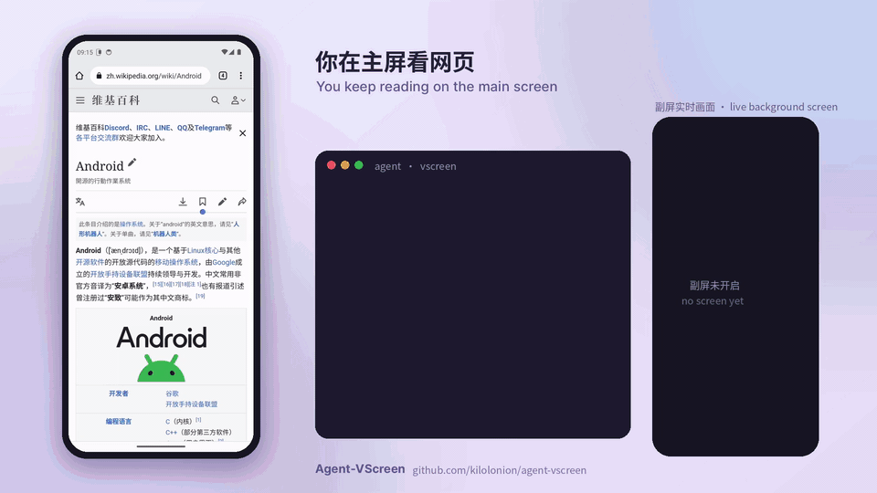
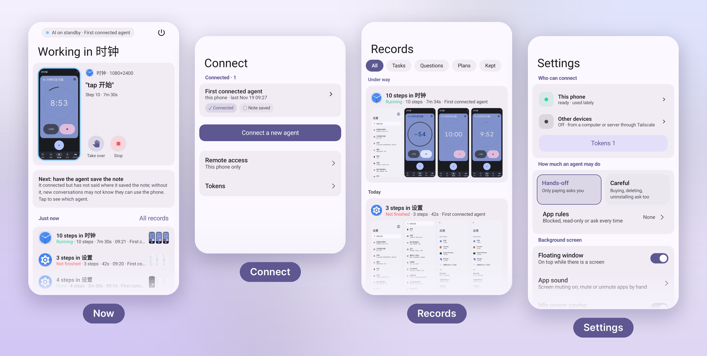

<p align="center"></p>

# Agent-VScreen

<p align="center">
  <a href="https://github.com/kilolonion/agent-vscreen/releases/latest"></a>
  <a href="LICENSE"></a>
  
  
  
</p>

**A background second screen for any phone agent.**

[中文](README.zh-CN.md) · English

Agent-VScreen opens and drives other apps on an invisible virtual display, so your own screen stays yours. All you see is a small floating window showing what the AI is doing, which you can take over or stop at any moment.

Any agent on the phone can use it: agents with a terminal use the `vscreen` CLI, agents that speak MCP use MCP, and your own code can use plain HTTP.

<p align="center"></p>
<p align="center"><sub>Left: an agent solves sudoku in Chrome on the background screen (8x speed). Right: an agent plays Roco Kingdom in landscape, walking with the joystick, dragging the camera and handling battle pop-ups (2.6x speed). In both, the user's own screen stays on the chat app.</sub></p>

<p align="center"></p>
<p align="center"><sub>One install command: four different Android agents (Minis, Eta, RikkaHub, Muse) all connect and drive the background screen.</sub></p>

<p align="center"></p>
<p align="center"><sub>The app: language switch, first-time setup, connecting an agent (this phone / Tailscale, CLI / MCP / HTTP), settings, app rules and diagnostics.</sub></p>

- Version: 1.2.0 (versionCode 13) · [Download APK](https://github.com/kilolonion/agent-vscreen/releases/latest)
- Package: `com.kilon.agentvscreen`
- Android 11+ (Android 14+ recommended), arm64
- Privileges: [Shizuku](https://shizuku.rikka.app/) only, no root

## What it does

- **Drives apps in the background**: launch apps, tap, swipe, type, press keys and wait for the screen to change on the virtual display, verifying every step.
- **Reports the screen back**: after each action it returns the current screen, visible text and tappable elements, plus a screenshot. Built-in offline OCR (PaddleOCR, on device). The app calls no LLM itself; your agent's own model decides what the screen means.
- **Watches**: keep an eye on the background screen for a condition (say, some text appearing) and notify the agent when it is met.
- **Floating window**:
  - The border color shows who has the screen: rainbow while the AI works, blue when idle, green when you have taken over, red when you stopped it;
  - Drag to move, pinch to resize, fling to throw it; fling to a corner to shrink, push to the edge to fold it into a tab;
  - Press and hold the picture for 1 second to take over;
  - × closes it with one tap: while the AI is working it only hides the window and the AI keeps going; with no task it closes the background screen;
  - "Stop AI" at the bottom left is the only thing that stops the AI; a persistent notification with "Allow to continue" releases it.
- **Leaves your agent's own access alone**: it does not take adb, touch wireless debugging or restart adbd. One-tap setup only adds this app and never changes other apps' settings.
- **App restrictions**: block apps entirely or make them read-only for the AI. Payment, delete and similar buttons still need your confirmation.

## More than a background screen: the scaffold around it

Agent-VScreen is more than a virtual screen an agent can use: it builds a whole scaffold around the background screen so that your own agent operates it directly, sees it clearly, keeps up with time, and knows whether each step really worked.

- **Time awareness**: while the agent works, the screen is looked at about 5 times a second and its text read about once a second, with timestamps. So every result's [Meanwhile] block tells what text appeared, disappeared or flashed from the last result until now (including the seconds the agent spent thinking or calling other tools), where the picture changed and for how long, with a contact sheet when it changed. Countdowns, loading, animations and pop-ups are not missed.
- **Waiting and watching**: after any action add an `until` condition (text appears, text disappears, picture changes, picture is still, a pixel's color, a given app is in front) with a time limit; if it never comes, the result says so. `--stop` is watched for the whole stretch, `--watch` keeps looking after the steps. `--keep notify|wake` keeps watching after the turn ends and notifies the user or wakes the agent when the condition shows up. For realtime games, saved pause and resume steps make every stretch resume first and pause at the end, so the game becomes turn-based.
- **Seeing clearly**: the accessibility tree and on-device OCR (bundled ML Kit, optionally the more accurate PP-OCRv6 small, both offline on the phone) are merged into numbered elements with coordinates, so `tap #N` and `tap <text on screen>` both work. OCR is split per character, so tabs on one line are separate targets and a part of a line can be tapped at its own center. There is also local color-spot finding (`spots`), zoom with a coordinate ruler (`zoom`), and scroll-and-collect of a whole page's text with deduplication (`collect`).
- **Every step checked**: a step that misses (until never came, the text is not in the box, focus is not where you tapped) stops the stretch there, skips the rest and describes the screen now; a missed tap lists the closest candidates.
- **Working with others**: sessions let several agents take turns on one screen (`BUSY` says whose it is and when it frees up); `handoff in/out` takes over an app the user has open on the main screen or hands it back; the user can take over or stop the AI at any time; per-app rules (blocked or read-only) and a confirmation stop for payment buttons (`CONFIRM_REQUIRED`). Each app can also keep notes and saved step segments (`--save` / `use`) that the next launch lists.
- **No model inside, no fight over privileges**: the phone side calls no model; the caller's model decides what the screen means. Only Shizuku is used: no wireless debugging pairing, no adb.

## Install and set up

The app UI is in Chinese for now; button names below are translated.

1. Install the APK and open Agent-VScreen.
2. Make sure Shizuku is running, then tap **Grant Shizuku**.
3. Tap **One-tap setup** for the overlay, notifications, read-only accessibility, battery optimization and background running. On Honor, Huawei, Xiaomi, OPPO, vivo and similar phones, also open **System background management** and allow auto-start and background activity.
4. In **Connect agent**, tap **Copy message for agent** and send it to your agent as is. It installs the `vscreen` command and saves a short guide into its own long-term memory, so new conversations know the tool is there. The home screen shows whether it remembered. Then:

```sh
vscreen launch Settings
vscreen act "tap Search; type About phone; key enter until text:About phone"
vscreen help all
```

## Use with Operit

Operit is just an example here; nothing is tailored to it. Other Android agents on the same phone work with the default install from "Connect an agent" (command line, MCP or HTTP), and cloud or desktop agents connect over Tailscale (see the next section).

There are two ways; pick one:

- **ToolPkg (recommended)**: import `agent-vscreen.toolpkg` built from [`integrations/operit`](integrations/operit/) (also in Releases), send the token to Operit's AI to save, and it works; screenshots go straight to the model. See that folder's README.
- **Remote MCP**: Operit and Operit 2 can both connect to remote MCP servers with no plugin, as follows.

1. Finish the first-time setup in Agent-VScreen and make sure the service is running.
2. Copy the token under **Connect an agent → MCP**.
3. Open Operit's MCP management page, tap **Import/Connect → Connect remote**, and fill in:
   - Name (plugin ID): `vscreen`
   - URL: `http://127.0.0.1:18765/mcp` (18765 is the default port; use yours if you changed it in the app)
   - Connection type: `httpStream`
   - Bearer Token: the token you just copied
4. Save and turn its switch on. Remote plugins need no "Deploy"; once the status shows active it is ready.
5. Try in a chat: "Use vscreen to open Settings on the virtual screen and tell me the system version."

You can also use **Config import**: paste the JSON below and tap **Merge config**:

```json
{
  "mcpServers": {
    "vscreen": {
      "url": "http://127.0.0.1:18765/mcp",
      "headers": { "Authorization": "Bearer <token>" }
    }
  }
}
```

Notes:

- Operit and Agent-VScreen must be on the same phone. If Operit runs on another device, replace the URL with the Tailscale address (see the next section).
- Operit's own screen tools and vscreen can coexist. To keep it on the background screen only, add to the character prompt: "Always use the vscreen tool to operate other apps; never touch the main screen."
- The token equals control of this phone: don't paste it into public character cards, shared configs or screenshots.

## Connecting from other devices (optional, off by default)

The service only listens on `127.0.0.1:18765`. To call it from a computer or another phone, choose **Another device (Tailscale)** in step 1 of "Connect an agent", then **Built-in**: no Tailscale app needed and no system VPN slot taken; sign in to Tailscale once inside the app and only devices on your own tailnet can reach it. **Tailscale app** mode and SSH port forwarding also work.

A self-hosted Headscale works too: enter its address under **Advanced** (for example `hs.example.com`; `https://` is added for you), then open the registration page or use a pre-auth key. Each server keeps its own login. The built-in node only carries what other devices send to Agent-VScreen, not the phone's own internet traffic, so it has no exit node. If the phone needs an exit node to get online, keep the Tailscale app on and choose **Tailscale app** mode.

The Tailscale setup sits right under that choice. Once connected, the message for your agent, the install command, the MCP config and the ability note all switch to the Tailscale address.

The app speaks Chinese or English (the **Language** card on the home page: System / 中文 / English), and so does everything it tells the agent.

The token equals control of the phone, so the app never offers a public link.

## 1.3.0-beta6 (pre-release)

- **Built-in Tailscale no longer drops in and out**: when the service or the built-in Tailscale was stopped and started again quickly (more common since 1.3: hide, wake, the switch), the old node could stay alive next to the new one. Two nodes with one identity took turns on the server and the relay, so the phone was online for a while and then gone. Now one node runs at a time: the app waits for the old one to exit, and the node itself refuses to start while another holds its state.
- **The Tailscale state is the real one**: "Connected" means the phone is in touch with the server and its relay, not only logged in. When either drops, the app and `status` say "dropped, reconnecting" with the cause, the relay in use and how often it dropped in the last 10 minutes; the relay and control events go to the diagnostics log.

## 1.3.0-beta5 (pre-release)

- **Seeing your own taps**: the [Meanwhile] sheet now has one frame just before each action, with a ring and number where it touched (a line for a drag) and the step written under it; the next frame, or [Now], is what it led to. Before, the dot was drawn on the frame after the action, and no sheet came when nothing changed, which is exactly when a wrong tap needs checking. Now a stretch that touched the screen always comes with its sheet.
- **`vscreen frames`**: look back at the recording. By default the stretch of the last reply; `--last 2m` for longer, `--every 0.3s` for denser, `--from 14:03:10 --to 14:03:30` for a given stretch, `--count` up to 36 and `--big` for larger frames. Many frames come as several pictures of 12, each listed with its clock time, how long ago, and the action before or after it. It says how much the recording still holds (every frame for 3 minutes, one a second up to 10).
- **Home**: "Block" is a small button at the end of the status line instead of a line of its own. The Connect tile lists each way agents come in with its own state: this phone (ready / woken on use) and, when turned on, Tailscale (connected, offline while hidden, log in…); the way the last call came by is marked "in use". The Connect page opens on that way.
- **A phone elsewhere that does not answer is no longer called "frozen"**: through a proxy or a userspace Tailscale the connection reaches the proxy, so the shell now gives the remote causes (hidden, blocked, offline, logged out) and narrows them with a ping when it can.

## 1.3.0-beta4 (pre-release)

- **Agents learn about app updates**: each agent confirms with `remembered` which version its note is for. After an app update, its next use of vscreen starts with what changed for agents since then, and asks it to read `guide` again, refresh its long-term memory or skill, and run `remembered`; until it does, the notice comes back about every 20 minutes or at a new conversation. The same for the shell, MCP and HTTP. `guide` and `status` show the app version and the note's version, and so does the Connect page in the app.
- **Two kinds of off: hidden and blocked**: this replaces beta2's on / paused / off. The home switch now means *always on* (a notification and the service in the background). Turning it off **hides** the app: no notification, nothing left in the background, but agents may still use the phone. A local command (the shell on the phone) or a booked time wakes it; the notification then says it was woken by an agent, and it hides again after 5 minutes with no calls, no background screen, no open question, no booked window and no watch. Other devices over Tailscale reach the phone only while it is awake, because the node lives in the service; for remote use at any time keep it always on. **Block agent access** is a separate button: nothing wakes it, a booking only notifies you ("Turn on now" button), and the shell says the user blocked access. The state is one line under the switch; "?" explains the difference. UNVERIFIED on some phones: after a reboot without Shizuku only a booking can wake it, and some systems clear an app's alarms when it is swiped from recents.
- **A booking while access is blocked says what it means**: the notification says the agent cannot use the phone this time and how to let it in, with a "Turn on now" button. Other problems open the app when tapped.
- **Built-in Tailscale login**: the home tile and the Connect page show one state: service off, connecting, log in, login expired, waiting for approval, connected, error. A login that worked once is remembered, so a stopped or starting node no longer says "not logged in" and shows the last address. The login card is step by step, and coming back to the app after logging in shows "Connected". A login link left for 10 minutes is replaced with a fresh one; a login about to expire is flagged two weeks ahead. `status.remote` gains `phase`, `user_action` and `last_ip`. When the shell cannot reach the phone and a tailscale command is installed, it pings first to tell "the phone's node is offline" from "the node is up but the app does not answer", and tells the agent where the user should look.

## 1.3.0-beta3 (pre-release)

- **The app, reorganised**: the home page holds the switch and the screen, anything waiting for you, and a set of tiles (Connect, Permissions, Screen & window, Schedules, Activity log, Setup), each showing its one key fact and opening its own page. Language and diagnostics sit at the bottom.
- **Explanations behind a "?"**: each setting keeps one short line; the full explanation is one tap away.
- **One glass look in the brand violet**: cards in the app, on the floating window and in full screen are translucent glass. While an agent waits for your answer, the question card on the window is dark glass over a blurred picture, and the folded tab is the same glass with a violet question mark or the number of open questions.
- **Question card and answer page redone**: who asks, which session and how long it stays open. Choices are lettered options you pick, then send; pointing or marking an area happens on a framed picture with Redo; yes/no questions are Allow / Deny. Send and Decline stay in the same place at the bottom.

## 1.3.0-beta2 (pre-release)

- **Checks judge only what came after the action**: `tap … until text:…` starts judging once the app has reacted (the picture changed, or accessibility reported a change) and the change has settled. `text:` counts words that appeared after the action; on a new page, whatever the new page shows. Words in the field just typed into do not count. When nothing changed after the action, the reply says the app did not react.
- **Numbers belong to one page**: on a new page (a new window, another front activity, or almost nothing in common with the last list), an old `#N` is `STALE_ELEMENT` and never lands on the same words on the new page. On the same page, numbers survive a scroll that moves everything together.
- **Areas that keep moving**: videos, live streams and carousels are recognized. Settling ignores them, their words are not listed in [Meanwhile] or [Now], and they no longer make a look read the screen twice. The reply says where they are. On a moving page, each step no longer waits out 3 s, and the screen is read once.
- **Time is reported as it was spent**: the last line of [Done] says how long the phone spent on this command: actions and waits, reading the screen, the track, the picture. [Meanwhile] splits time into outside the phone (the reply and picture in transit, you reading and thinking) and since this command reached the phone. A step over 1.5 s and getting ready over 1 s are said.
- **Faster CLI**: the liveness check goes out together with the command instead of one round trip before it. Pictures are smaller.
- **One element per place**: where the app's own element has words (text or description), those are the element; the OCR reading of the same place is no longer listed again. A wordless button is named by the words drawn inside it. Content hidden as "link / id" is no longer read out by OCR.
- **collect by cards**: one card or list row is one item, with all its words; two columns are no longer merged. Bars that stay in place while scrolling are recorded on the first screen only. A cancelled or interrupted collection returns what it had and says where it stopped.
- **Main-screen note only when we disturbed it**: `MAIN_SCREEN_CHANGED` is reported only when an app or task of ours came to the main screen. You switching apps on the main screen is no longer reported.
- **Background screen is muted**: apps on the background screen make no sound on the phone. Their sound comes back when they move to the main screen, when the screen is released, or when you turn off "Mute the background screen" under Settings › Background screen. After a crash it is given back once the connection is up again.
- **Smoother remote access**: requests through the built-in Tailscale come from a device Tailscale has identified, over its encrypted tunnel: a token is enough, no signing (MCP clients connect remotely as they are), and the Host is no longer checked. "Signed requests only" applies to requests through the external Tailscale app. The CLI skips proxies only for the phone's own address; a remote one follows `http_proxy` / `no_proxy`, or `VSCREEN_PROXY` (e.g. `socks5h://127.0.0.1:1055`). A request over 1 MB is refused from its declared length, and one not fully sent within 30 s is dropped.
- **Schedules**: book once only (`today 10:30`, `tomorrow 07:00`, `once 10:30`, `11-15 10:30`), removed when over; the same booking from the same session is not added twice; a window in progress still shows as "next"; a window is checked and announced once, and changing other bookings no longer reopens it.
- **On, paused, off**: the service has just these three states, and the home-page switch and the notification actions are the same thing. With a booking, turning the service off asks once: **Pause until HH:MM** (it turns itself on for the next booking, which works as usual) or **Turn off** (it stays off; the window only checks and notifies you, and the agent is told the service is off). The line under the switch says which one it is, and one tap changes it. With a booking, the notification gets "Pause until HH:MM" next to "Stop service". Swiping the app away from recents does not stop the service (agents must be able to reach the phone); the × on the floating window only closes the background screen.
- **The floating window tells you when it has a question**: while an agent waits for your answer (`ask`), the tab folded at the screen edge turns into a pulsing violet question mark, with a question mark or the number of open questions, unlike standby and acting. Expand the window or open fullscreen and the question is right there: tap Allow / Deny for a yes/no, tap an option for a choice; for pointing, marking an area or a text answer, one tap opens the answer screen. You can always decline.
- **`ask --async`** waits until you answer (within the question's 10 minutes); `task` returns the answer.
- **`launch` and `apps` match the same way**: English names and words of the package (settings, calculator) are found, and the first app `apps` lists is the one `launch` opens.
- **collect says where it started**: it says when there is more above; `--from-top` goes to the top first. A value below an option's minimum is `INVALID_ARGS`; above the maximum it is clamped and every command says "options adjusted".
- **Events**: events given again after an app restart are marked as repeats, with the same number.
- **The CLI tells two failures apart**: the phone cannot be reached (Tailscale offline) versus reached but the app does not answer (frozen).
- **Other**: `launch` reconnects by itself after the connection dropped, instead of asking for `vscreen fix not_connected` first. `TIME_SKEW` says whether the request is ahead of or behind the phone. Diagnostics no longer repeat the built-in Tailscale's login prompt and link.

Not verified on a phone yet: whether turning an app's sound off with `PLAY_AUDIO` works for every player on MagicOS; whether accessibility events carry their display (if not, a change on any screen counts as "the app reacted", and the result still rests on where the words were before and after the action).

## 1.3.0-beta1 (pre-release)

- **On call for timed agents**: `vscreen schedule "weekdays 07:00"` books the times an agent will use the phone. Three minutes before each one, an exact alarm starts the service, asks the system for a temporary power exemption (through Shizuku), re-checks the connection and records whether everything is ready. If something blocks it, for example Shizuku not running after a restart, you get a notification in time to fix it. The agent gets the result as an event. Booked times are listed under Settings › Scheduled times.
- **One answer to "is it ready?"**: `vscreen status` starts with `ready` and `readiness` (what blocks, what only warns), and `/v2/ping` carries `ready` too. The schedule check uses the same rules.
- **No more silent hangs on this phone**: when the app does not answer for 5 s, the CLI wakes it with an explicit broadcast and tries again. If that fails, it stops with `NOT_READY` and says why instead of waiting.
- **Show me**: `vscreen ask "Which one do you mean?"` puts the question on the phone. You tap the place on a picture of the background screen, and the agent gets the point and the element there. `--area` (a box), `--choose "A|B"` and `--text` work too. Confirmations and questions now go through one channel and show as one list in the app.
- **Long tasks keep their turn**: a command started with `--async` now counts as activity until it finishes, so the turn no longer ends under it.

Not yet verified on a phone: whether vendor background managers (MagicOS, MIUI …) honour the exact alarm, the temporary exemption and the wake-up broadcast for an app they froze.

## What's new in 1.2.0

This version rebuilds the command gate, the reply format, the security model and the guide for agents, and went through two real-phone regression rounds with [docs/TASKS.md](docs/TASKS.md) (Honor Magic 7, MagicOS 11). The upgrade table from 1.1 is in section 9 of [API.md](API.md).

- **Structured results**: every reply carries `ok`, `code` and `next` (look at the screen / fix the command / ask the user / retry later), plus each step's status, the screen's elements and the notes. A stretch that stops at a step is a failure; no reading text to find out. The new API is `/v2`; `/v1` is unchanged and stays for one more version.
- **One command table**: option checks, help, MCP tool schemas and the docs are generated from it. MCP has one tool per command besides `vscreen`.
- **More precise taps**: text that appears several times is listed with coordinates instead of tapping the first; a `#number` whose element moved away is not tapped at its old place; an action that changed nothing is flagged.
- **Shorter waits**: a page left with only a spinner or blinking cursor counts as settled. Perception is driven by new frames.
- **One input path**: taps, swipes and keys are injected by the display service; dumpsys parsing and shell `input` are gone.
- **A token per agent**: look-only / operate / everything, revoked separately, with separate sessions.
- **Signed requests**: from another device the token never travels, requests cannot be replayed or altered, and replies are verified. The CLI does it by itself.
- **The user confirms on the phone**: payment, irreversible steps, force-stop, taking an app off the main screen, and apps set to "ask every time". A flag added by the agent no longer counts. A trusted agent can be given 30 minutes without confirmations.
- **Activity log**: who ran which command, when, with what result. Typed text is recorded as a length only.
- **Harder to knock over**: connection cap, request size and time limits; a command stops when its caller disconnects; a resent request never runs twice; long work can run `--async` and be collected with `task`; commands queue.
- **Events are not lost**: kept until the next fetch, re-fetchable, stored on disk; watches resume after an app restart; the event broadcast goes only to an app you name.
- **A rewritten guide for agents**: built around one loop (look → act → check), with what to do next for each result code; `vscreen guide` is one page.

- **Hands-off by default**: Permissions in the app has two levels. The default, "hands-off", asks you on the phone only for the step that actually spends money (pay, place order, transfer, top up) and for apps you set to "ask every time"; "careful" also asks for irreversible buttons such as delete, steps toward a purchase, force-stop and taking an app off the main screen. The "clear" button next to an input box is no longer treated as irreversible.
- **A new page layout**: the home page goes Connect → Permissions → Settings → Activity log; permissions live in one place (level, app rules, tokens) and settings are grouped (floating window / background screen / reading and recording).
- **A smoother floating window**: its picture is scaled to the size shown at 20 frames a second (30 while you control the screen) instead of the agent's full-size frames; moving the window updates its position once per display frame, so it stays under the finger; after taking over, your finger reaches the screen as it moves, so lists follow it. A landscape screen opens almost as wide as the phone, and each orientation keeps its own size.
- **Look-only tokens can look**: their `act` (no steps or only waits) looks at the screen in use; `stop --force` and `handoff in` need the "everything" scope.
- **Numbers never point at the wrong element**: on one screen a number names one element; after a scroll the same element keeps its number and new ones get new numbers. A number whose element left the screen gives STALE_ELEMENT instead of tapping something else.
- **Floating window**: a landscape screen opens at about three quarters of the phone's width, and the whole window stays on screen when it appears or turns.
## Docs

- [API.md](API.md) (Chinese): the full CLI, MCP and HTTP reference, sessions, watches, permissions and security, the floating window, remote access, known limits and upgrading from 1.1.
- [docs/REFERENCE.md](docs/REFERENCE.md): every command option and result code (generated from the source).
- [docs/TASKS.md](docs/TASKS.md): the fixed task set to run on a real phone before a release.

## Build from source

JDK 17 and the Android SDK (compileSdk 36).

```bash
echo "sdk.dir=/path/to/android-sdk" > local.properties
./gradlew :app:assembleRelease
```

Built-in Tailscale is a small Go program (`tsbridge/`, Go 1.21+). Run `tsbridge/build.sh` once before building to produce `app/src/main/jniLibs/arm64-v8a/libtsbridge.so`; without it the APK still builds, just without built-in Tailscale.

Release signing is optional: copy `keystore.properties.example` to `keystore.properties` and fill it in. Otherwise release builds are signed with the debug key.

## License

MIT. The bundled OCR models (`app/src/main/assets/vscreen-ocr/`) come from PaddleOCR under their own Apache-2.0 license.

## Thanks

- [LINUX DO](https://linux.do)
- [OpenMinis](https://github.com/OpenMinis)
