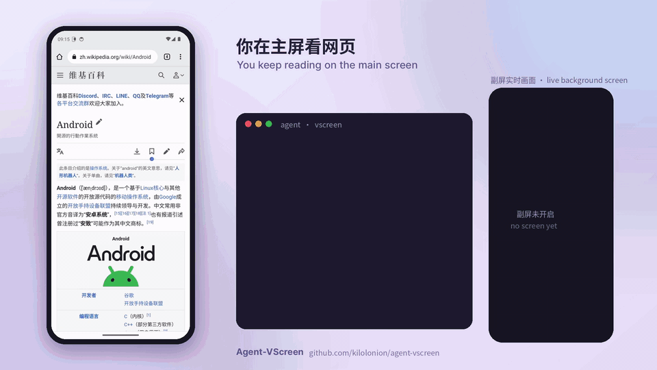

<p align="center"></p>

# Agent-VScreen

<p align="center">
  <a href="https://github.com/kilolonion/agent-vscreen/releases/latest"></a>
  <a href="LICENSE"></a>
  
  
  
</p>

给任何手机 agent 用的**后台副屏**。

中文 · [English](README.md)

Agent-VScreen 在一块看不见的虚拟屏上打开和操作别的应用，你的主屏照常用，不会被打断。屏幕上只有一个悬浮小窗，让你看到 AI 在做什么，随时可以接管或叫停。

手机上的任何 agent 都可以调用它：带终端的 agent 用命令行 `vscreen`，支持 MCP 的用 MCP，自己写代码的用 HTTP。

<p align="center"></p>
<p align="center"><sub>左：agent 在后台副屏里打开 Chrome 解数独（8 倍速）。右：agent 在后台副屏里玩洛克王国，完成横屏启动、摇杆长按走动、拖动镜头和战斗弹窗操作（2.6 倍速）。两边用户的主屏都仍是聊天界面。</sub></p>

<p align="center"></p>
<p align="center"><sub>同一条安装命令，Minis、Eta、RikkaHub、Muse 四个不同的安卓 agent 都能接入并操作副屏。</sub></p>

<p align="center"></p>
<p align="center"><sub>App 界面：语言切换、首次配置、接入 agent（本机 / Tailscale，命令行 / MCP / HTTP）、设置、应用限制和诊断。</sub></p>

- 版本：1.2.0（versionCode 13）
- 包名：`com.kilon.agentvscreen`
- 系统：Android 11 及以上，推荐 Android 14 及以上
- 特权：只用 [Shizuku](https://shizuku.rikka.app/)，不需要 root

## 它能做什么

- **后台操作应用**：在副屏上启动应用、点击、滑动、输入文字、按键、等待画面变化，每一步都会核对结果。
- **把画面报告给 agent**：每次操作后返回现在的界面、能看到的文字和可点的元素，并附上截图。本应用不调用任何大模型，画面是什么意思由 agent 自己的模型判断。
- **盯守**：让副屏盯着某个条件（比如出现某段文字），满足时通知 agent。
- **悬浮窗**：
  - 边框的颜色表示现在谁在用副屏：彩虹色是 AI 在操作，蓝色是待命，绿色是你接管了，红色是你叫停了；
  - 拖动可以移动，双指捏合可以缩放；松手时手指还在动，小窗会顺势滑一段；
  - 甩向四个角会缩到最小，靠近屏幕边缘会折成贴边的小标签；
  - 按住画面 1 秒就能接管；
  - 右上角 × 点一下就关：AI 在工作时只收起小窗，AI 继续在后台干活；没有任务时直接关掉副屏。关闭不会停住 AI；
  - 左下角“停止 AI”才会停住 AI，停住后通知栏一直有提示，点“允许继续”就放开；
  - 也可以打开原生全屏页。
- **不和 agent 抢权限**：不占用 adb，不改无线调试的开关和端口，不重启 adbd。你的 agent 自己用的 adb 或 Shizuku 照常可用。一键配置只会把本应用“加进去”，不会改动别的应用的设置。

## 不只是一块副屏：围绕副屏的脚手架

Agent-VScreen 不只是一块能让 agent 用的虚拟屏，而是围绕副屏搭了一整套脚手架，让你自己的 agent 直接操作，并且看得清、跟得上时间、知道每一步是否真的做成了。

- **有时间感**：agent 工作时，后台每秒看副屏约 5 次，大约每秒读一次屏上的字，并记下时间。所以每次返回的【这段时间】会写出从上次返回到现在（包括 agent 思考、调别的工具的那几秒）出现、消失、一闪而过的字，画面哪里变了、变了多久，有变化时还附一张拼图。倒计时、加载、动画、弹窗这类会变的画面也跟得上。
- **能等、能盯**：每个动作后可以加 `until` 条件（出现某字、某字消失、画面变化、画面静止、某点颜色、切到某应用），写明最长等多久，等不到会照实说。`--stop` 在整段操作里一直盯着，`--watch` 做完再多看一会儿。`--keep notify|wake` 在这一轮结束后继续替 agent 盯，条件出现就通知用户或叫醒 agent。实时游戏记下暂停和继续两步后，每段操作会自动先继续、末尾暂停，变成回合制。
- **看得清**：无障碍控件树和本机 OCR（内置 ML Kit，可选更准的 PP-OCRv6 small，都在手机上离线运行）合并成带编号和坐标的元素列表，`tap #N` 或 `tap 画面上的字` 都能点。OCR 按字符切分，同一行里的几个标签能分开点，也能只点一段字的中心。另外有本地按颜色找色块（`spots`）、带坐标刻度的放大图（`zoom`）、边滚边收集整页文字并去重（`collect`）。
- **每步都核对**：一步没达到预期（`until` 没等到、字没输进框里、焦点不在刚点的地方）就停在那一步，后面的不做，并写明现在的画面；没点中时会列出最接近的候选。
- **多方协作**：会话机制让多个 agent 轮流用同一块副屏（别人在用时返回 `BUSY`，写明多久后让出）；`handoff in/out` 把用户主屏上正在用的应用接过来或交还；用户随时能接管或叫停；应用限制（禁止或只读）和付费按钮的确认拦截（`CONFIRM_REQUIRED`）。每个应用还能记笔记、存操作段（`--save` / `use`），下次打开时列出来。
- **不绑模型，不抢权限**：手机侧不调用任何模型，画面是什么意思由调用方的模型判断。只用 Shizuku，不需要配对无线调试，也不占用 adb。

## 安装和配置

1. 安装 APK，打开 Agent-VScreen。
2. 确认 Shizuku 已经启动，然后点 **授权 Shizuku**。
3. 点 **一键配置其余项**：悬浮窗、通知、只读无障碍、电池优化和后台运行。荣耀、华为、小米、OPPO、vivo 等手机还有一项 **系统后台管理**，点 **去设置后台管理**，把 Agent-VScreen 改成手动管理，允许自启动、关联启动和后台活动。
   - 无障碍建议打开。开着它，悬浮窗不会在设置、安装器这类页面上被系统藏起来，元素列表和中文输入也更准。
4. 在 **接入 agent** 里点 **复制给 agent 的话**，原样发给你的 agent。它会装好 `vscreen` 命令，并按你的要求把一段说明存进它自己的长期记忆，以后的新对话里也知道手机上有这个工具。首页会显示它有没有记住。之后就能用 `vscreen` 了：

```sh
vscreen launch 设置
vscreen act "tap 搜索; type 关于手机; key enter until text:关于手机"
vscreen help all
```

### 荣耀、华为、小米等手机

这些系统的后台管理可能会把后台应用冻结。冻结后，agent 的命令会一直没有回应，直到你打开 Agent-VScreen。

1.1.3 做了这些防护：

- 服务运行时一直保留一个透明的 1 像素悬浮窗；
- 前台服务启动被拒时，改用 shell 身份重新启动；
- 每秒自检一次有没有被冻结。

如果首页出现 **后台运行受限**，点 **去设置**，把 Agent-VScreen 设为允许自启动、关联启动和后台活动。荣耀和华为在“应用启动管理”里改成“手动管理”。

## 在 Operit 中使用

下面以 Operit 为例。这不是专门为 Operit 做的适配：同一台手机上的其他安卓 agent，按“接入 agent”里的命令行、MCP 或 HTTP 方式默认安装就能用；云端或电脑上的 agent 用 Tailscale 连进来，见下一节。

有两种接法，任选一种：

- **ToolPkg（推荐）**：导入 [`integrations/operit`](integrations/operit/) 打出的 `agent-vscreen.toolpkg`（Releases 里也有），把令牌发给 Operit 的 AI 让它保存就能用，截图会直接给到模型。详见那个目录的 README。
- **远程 MCP**：Operit 和 Operit 2 都能连远程 MCP，不用装任何插件，步骤如下。

1. 在 Agent-VScreen 里完成首次配置，确认服务在运行。
2. 在 **接入 agent → MCP** 里复制令牌。
3. 打开 Operit 的 MCP 管理页，点 **导入/连接 → 连接远程**，填：
   - 名称（插件 ID）：`vscreen`
   - 地址：`http://127.0.0.1:18765/mcp`（18765 是默认端口，在 App 里改过端口的话换成你的）
   - 连接方式：`httpStream`
   - Bearer Token：刚复制的令牌
4. 保存后打开它的开关。远程插件不用点“部署”，状态变成 active 就能用。
5. 在聊天里试一句：“用 vscreen 在虚拟屏打开设置，告诉我系统版本。”

也可以用 **配置导入**，粘贴下面的 JSON 后点 **合并配置**：

```json
{
  "mcpServers": {
    "vscreen": {
      "url": "http://127.0.0.1:18765/mcp",
      "headers": { "Authorization": "Bearer <令牌>" }
    }
  }
}
```

注意：

- Operit 和 Agent-VScreen 要在同一台手机上。Operit 在别的设备上时，把地址换成 Tailscale 地址，见下一节。
- Operit 自带的屏幕操作工具和 vscreen 可以共存。想让它只用副屏，在角色提示词里写：“操作其它应用时一律用 vscreen 工具，不要动主屏。”
- 令牌等于这台手机的操作权限，不要贴进公开的角色卡、分享的配置或截图。

## 让其它设备连进来（可选，默认关闭）

服务默认只监听本机的 `127.0.0.1:18765`。要从电脑或另一台手机调用，在“接入 agent”第一步 **agent 在哪** 选 **其它设备上（Tailscale）**，再选 **内置**：不用装 Tailscale App，也不占系统 VPN，在 App 里登录一次 Tailscale 就行，只有你自己 Tailscale 网络里的设备连得进来。已经装了 Tailscale App 的也可以选 **Tailscale App**，或者用 SSH 端口转发。

自建的 Headscale 也能用：在 **高级选项** 里填它的地址（比如 `hs.example.com`，`https://` 会自动补上），再打开注册页或填预授权 key。每个服务器的登录分开保存。内置节点只负责让其它设备连到 Agent-VScreen，不接管手机自己的上网，所以没有出口节点；手机要靠出口节点上网时，让 Tailscale App 一直开着，选 **Tailscale App** 模式就行。

Tailscale 的设置就在这个选项下面。连好后，下面复制的给 agent 的话、安装命令、MCP 配置和能力说明就都换成 Tailscale 地址，直接发给那台设备上的 agent。

令牌等于这台手机的操作权限，所以本应用不提供公网链接。

## 文档

- [API.md](API.md)：完整的接口说明，包括命令行、MCP、HTTP、会话、盯守、权限和安全、悬浮窗、远程连接、已知限制和从 1.1 升级。
- [docs/REFERENCE.md](docs/REFERENCE.md)：每条命令的参数和每个结果代码（由代码生成）。
- [docs/TASKS.md](docs/TASKS.md)：发版前在真机上跑的固定任务集。

## 1.3.0-beta4（预发布）

- **App 更新后，agent 会知道**：每个 agent 用 `remembered` 确认自己记下的说明对应哪个版本。App 更新后，它下一次用 vscreen 时，返回最前面会写出这几版里和它有关的变化，并请它重读 `guide`、更新自己的长期记忆或 skill，再执行 `remembered`；确认之前大约每 20 分钟或每次新对话提醒一次。命令行、MCP、HTTP 都一样。`guide` 和 `status` 会写出 App 版本和 agent 说明的版本，App 的“接入 agent”页也会显示。
- **两种“关”：收起和禁止访问**：取代 beta2 的运行 / 暂停 / 关闭。首页开关现在表示**常驻**（有通知、服务留在后台）。关掉开关是**收起**：通知和后台都消失，但 agent 仍然可以用手机。本机命令（手机上的命令行）或预约时间到了会把它叫醒，通知会写“被 agent 叫醒”；5 分钟没有调用、没有副屏、没有待回答的问题、不在预约时段、没有盯守时，它会自己再收起。其它设备经 Tailscale 只能在它醒着时连上，因为节点在服务里；要远程随时用请保持常驻。**禁止 agent 访问**是单独的按钮：什么都叫不醒，预约到点只通知你（带“现在打开服务”），命令行会说用户禁止了访问。开关下面只有一行状态，点“?”看两者的区别。未在所有机型验证：重启后没有 Shizuku 时只有预约能叫醒；有的系统从最近任务划掉 App 会清掉它的闹钟。
- **预约到点但禁止了访问时，通知说清楚**：通知写明这次 agent 用不了手机、怎样让它进来，并带一个“现在打开服务”按钮。别的问题挡住时，点通知会打开 App。
- **内置 Tailscale 登录**：首页和“接入 agent”页按同一个状态显示：服务关着、连接中、要登录、登录过期、等待批准、已连上、出错。登录成功一次后会记住，服务关着或刚启动时不再显示“未登录”，而是显示上次的地址。登录页一步一步写清楚，回到 App 连上后会提示“已连上”。登录链接放了 10 分钟会自动换新的；登录快过期时提前两周提醒。`status` 的 `remote` 增加了 `phase`、`user_action`、`last_ip`。命令行连不上手机时，如果本机装了 tailscale，会先 ping 一下，分清是手机的节点不在线，还是节点在线、App 没回应，再告诉 agent 该请用户看哪里。

## 1.3.0-beta3（预发布）

- **界面重新整理**：首页只放开关和副屏状态、等你处理的事，以及一组卡片（接入 agent、权限、副屏与悬浮窗、定时预约、操作日志、首次配置），每张卡片写着最要紧的一项状态，点进去是各自的页面。语言和诊断在最下面。
- **说明收进问号**：每个设置下只留一句短话，完整说明点旁边的“?”看。
- **统一的玻璃质感和紫色系**：App、悬浮窗、全屏里的卡片都是半透明玻璃。agent 在等你回答时，悬浮窗上的提问卡是深色玻璃，后面的画面会变模糊；收在边上的胶囊是同样的玻璃，带紫色的问号或待回答个数。
- **提问卡片和回答页重做**：写着谁在问、哪个会话、还剩多久。选择题是带字母的选项，选好再发送；指一下、框一块时画面带边框，可以“重来”；确认题直接“允许 / 拒绝”。发送和不回答固定在底部同一个位置。

## 1.3.0-beta2（预发布）

- **核对只认动作之后的画面**：`tap … until text:…` 要等应用对这一下有了反应（画面变了，或无障碍报告了变化），并且变化稳定下来，才开始判断。`text:` 只算动作之后新出现的字；换了页面就以新页面为准。刚输入的那个输入框里的字不算。动作后画面一直没变时，会直接说“应用没有反应”。
- **编号属于一个页面**：换了页面（新窗口、前台 Activity 变了，或和上一页几乎没有相同元素），旧的 `#编号` 一律报 `STALE_ELEMENT`，不会点到新页面上同名的字。同一页滚动后，元素整体移动时编号不变。
- **画面里一直在动的区域**：视频、直播、轮播会被识别出来。判断画面是否稳定时不算它，里面的字不列进【这段时间】和【现在】，读屏时也不会因为它重读。回执会写出这块区域在哪。画面在动时，每步不再白等 3 秒，读屏也不再读两遍。
- **耗时如实写**：【做了什么】最后一行写手机端这条用了多久，分成动作和等待、读屏、录像、出图。【这段时间】把时间分成手机之外（回复和图片在路上、你在看和思考）和这条命令到手机后两部分。单步超过 1.5 秒、开始前的准备超过 1 秒，都会写出来。
- **命令行更快**：存活检查和命令同时发出，不再先等一次往返。截图体积更小。
- **一处一条元素**：有无障碍文字或描述的地方以它为准，同一位置的 OCR 文字不再重复列出。没有文字的按钮用画在里面的字命名。隐藏成“链接/标识”的内容不会再被 OCR 读出来。
- **collect 按卡片收集**：一张卡片或一行列表是一条（包括它里面的所有字），双列不会再拼在一起。滚动时位置不变的吸顶栏、底栏只在第一屏记。取消或中断时返回已经收集到的条目，并说明停在第几屏。
- **主屏提示只在我们打扰时出现**：只有副屏这边的应用或任务跑到了主屏，才报 `MAIN_SCREEN_CHANGED`。你在主屏上照常切换应用不再报。
- **副屏静音**：副屏里的应用不从手机放声音。应用移到主屏、副屏释放、或你在 设置 › 副屏 关掉“副屏静音”时恢复。App 异常退出后，下次连接上会先恢复。
- **远程更顺**：经内置 Tailscale 进来的请求由 Tailscale 认出设备并加密，带令牌即可，不用签名（MCP 客户端可以直接远程接入），也不再检查 Host。“只接受签名请求”只管经外部 Tailscale App 来的请求。命令行只对本机地址跳过代理，其它地址按 `http_proxy`/`no_proxy` 走，也可以用 `VSCREEN_PROXY` 指定（例如 `socks5h://127.0.0.1:1055`）。超过 1 MB 的请求按声明的长度直接拒绝，30 秒内没发完的请求会被断开。
- **预约**：可以只约一次（`today 10:30`、`tomorrow 07:00`、`once 10:30`、`11-15 10:30`），过了自动删除；同一会话同样的预约不会重复添加；进行中的窗口在列表里仍显示为“下一次”；一个窗口只检查和通知一次，增删别的预约不会再重开它。
- **运行、暂停、关闭**：服务只有这三种状态，首页开关和通知栏的操作是同一套。agent 有预约时，关服务会问你一次：**暂停到 HH:MM**（到下一个预约自动打开，预约照常）还是**完全关闭**（到点不打开，只检查并通知你，agent 收到“服务关着”）。开关下面写着现在是哪一种，点一下可以改成另一种。有预约时，通知栏的“停止服务”旁边多一个“暂停到 HH:MM”。从最近任务里划掉 App 不会停服务（agent 随时要能连上）；悬浮窗的 × 只收起副屏，不停服务。
- **有事问你时，悬浮窗自己会提醒**：agent 在等你回答（`ask`）时，收在屏幕边上的胶囊变成紫色问号、一闪一闪，里面是问号或待回答的个数，和待命、操作中都不一样。展开悬浮窗或打开全屏，问题就在上面：确认题直接点“允许 / 拒绝”，选择题直接点选项，指一下、框一块、写文字的点一下就进到回答界面；都可以“不回答”。
- **`ask --async`** 一直等到你回答（问题有效的 10 分钟内），用 `task` 取答案。
- **`launch` 和 `apps` 用同一套匹配**：英文名、包名里的词（settings、calculator）都能找到，`apps` 列出的第一个就是 `launch` 打开的那个。
- **collect 说明起点**：上面还有内容时会写出来；`--from-top` 先回到顶部。参数小于下限直接报 `INVALID_ARGS`；超过上限按上限执行，并在任何命令的返回里写“参数被调整”。
- **事件**：App 重启后重发的事件标明“重发”，编号不变。
- **命令行判断更准**：连不上手机（Tailscale 不在线）和连上了但 App 不回应（被冻结）分开说明。
- **其它**：`launch` 遇到连接断开会自己重连，不再要求先 `vscreen fix not_connected`。`TIME_SKEW` 写明请求比手机快还是慢。诊断里不再反复出现内置 Tailscale 的登录提示和链接。

还没在真机上验证：MagicOS 上用 `PLAY_AUDIO` 关掉应用声音，是否对所有播放器都有效；无障碍事件是否带屏幕编号（不带时，任何屏幕上的变化都会算作“有反应”，结果仍以动作前后字的位置为准）。

## 1.3.0-beta1（预发布）

- **定时任务随叫随到**：agent 用 `vscreen schedule "weekdays 07:00"` 预约它会来用手机的时间。每次到点前 3 分钟，精确闹钟会拉起服务，通过 Shizuku 向系统申请临时省电豁免，重新检查连接，并记下是否就绪。如果有问题挡住（例如重启后 Shizuku 没运行），你会及时收到通知去处理，agent 也会以事件的形式收到检查结果。预约的时间列在 设置 › 定时预约。
- **“能不能用”只有一个答案**：`vscreen status` 开头是 `ready` 和 `readiness`（哪些会挡住，哪些只是提醒），`/v2/ping` 也带 `ready`。预约检查用的是同一套规则。
- **本机不再无声地卡住**：App 5 秒没有响应时，命令行会先用一个显式广播唤醒它，然后重试；还不行就以 `NOT_READY` 结束并说明原因，不再一直等。
- **指给我看**：`vscreen ask "你说的是哪一个？"` 会把问题放到手机上。你在副屏画面上点一下，agent 就拿到坐标和那里的元素。也支持 `--area`（框选）、`--choose "甲|乙"` 和 `--text`。确认和提问现在走同一个通道，在 App 里显示成同一个列表。
- **长任务不会中途丢掉这一轮**：用 `--async` 开始的命令在做完之前都算活动，这一轮不会在它还在做时结束。

还没在真机上验证：厂商的后台管理（MagicOS、MIUI 等）对已被冻结的 App，是否会放行精确闹钟、临时豁免和唤醒广播。

## 1.2.0 更新内容

这一版重做了命令入口、返回格式、安全模型和给 agent 的说明，并在真机上按 [docs/TASKS.md](docs/TASKS.md) 跑过两轮回归（荣耀 Magic 7，MagicOS 11）。从 1.1 升级的对照表在 [API.md 第 9 节](API.md)。

- **结果是结构化的**：每次回复带 `ok`、`code`、`next`（建议的下一步：先看画面 / 改命令 / 问用户 / 稍后重试），以及每一步的状态、画面元素和提示。一段操作停在某一步时结果就是失败，不用再从文字里判断。新接口是 `/v2`，`/v1` 行为不变，再保留一个版本。
- **一张命令表**：参数检查、帮助、MCP 工具的参数和文档都从同一张表生成。MCP 除了 `vscreen`，每条命令有自己的工具，参数是字段。
- **点得更准**：同样的字有好几处时不再点第一个，而是列出每一处让 agent 选；`#编号` 指的元素不在原位时不再点旧坐标；动作后画面完全没变会提示。
- **等得更短**：页面上只剩转圈、光标闪烁这类小动画时算稳定，不再每一步等满 3 秒。感知改成新画面驱动。
- **输入只走一条通道**：点击、滑动、按键全部由副屏服务注入，去掉了解析 dumpsys 文本和调用 shell `input` 的旧路径。
- **每个 agent 一个令牌**：可以限定只看 / 可操作 / 全部，单独撤销，会话互不相干。
- **请求签名**：从其它设备连接时令牌不上网络，请求不能重放或改动，回复也校验。命令行自动完成。
- **用户在手机上确认**：付费、不可撤销、强制结束、接走主屏应用、设为“每次询问”的应用，都由你在手机上点允许。agent 自己加参数不再算数。可以给信任的 agent 开 30 分钟免确认。
- **操作日志**：每条命令谁做的、什么时候、结果如何。输入的文字只记字数。
- **不容易被拖垮**：HTTP 服务有连接数上限、请求大小和时间限制；调用方断开后命令会停下；同一个请求重发不会执行两遍；长操作可以 `--async` 后用 `task` 取结果；命令排队执行。
- **事件不丢**：盯守的事件保留到下一次取，可以重取，写在磁盘上；盯守在 App 重启后接着盯；事件广播默认不发，只发给你指定的应用。
- **给 agent 的说明重写了**：围绕“看 → 做 → 核对”一个循环，按结果代码写明每种情况下一步怎么办，`vscreen guide` 一页讲完。
- **其它**：`note before` / `note after` 取代暂停 / 继续步骤；`--fast`；`vscreen diag` 导出诊断；截图随副屏清理；厂商差异收进一层；去掉了早期遗留的代码和名字。

- **默认放手跑**：App 的“权限”里有两档。默认“放手跑”只有真正付钱的那一步（支付、提交订单、转账、充值）和你设为“每次询问”的应用会在手机上问你；“谨慎”档再加上删除这类不可撤销的按钮、去购买的步骤、强制结束和接走主屏应用。输入框旁边的“清空”不再被当成不可撤销。
- **页面重排**：首页按“接入 → 权限 → 设置 → 操作日志”排，权限一处管（档位、应用限制、令牌），设置按悬浮窗 / 副屏 / 识别和记录分组。
- **悬浮窗更顺**：画面单独按显示尺寸缩小、每秒 20 帧（接管时 30 帧），不再用 agent 的整幅截图；拖动窗口每帧只更新一次位置，不再拖后；接管后手指按下就传到副屏，列表跟着手指走，不再松手才动。横屏副屏默认几乎和手机一样宽，横竖屏各记各的大小。
- **只看令牌能看了**：只看令牌的 `act`（不带步骤或只有 wait）看的是当前那块副屏；`stop --force`、`handoff in` 需要“全部”范围。
- **编号不会认错人**：同一块副屏上，一个编号只指一个元素；滚动后同一个元素保留原编号，新元素拿新编号。用了已经不在画面上的旧编号会得到 STALE_ELEMENT，不会点到别的东西。
- **悬浮窗**：横屏副屏默认约为手机宽度的四分之三，出现和换方向时整个窗口都留在屏幕内。
## 1.1.x 更新内容

- **1.1.8**
  - 内置 Tailscale 支持自建 Headscale：控制服务器地址不写 `https://` 也行（以前少了它节点会一直停在 NeedsLogin，页面却说连不上 Tailscale 官方服务器）；每个服务器的登录状态分开保存，从 Tailscale 换到 Headscale 不会带着旧的登录，填了预授权 key 一定会用它注册；连不上时页面直接写出是哪个服务器、出了什么错；注册页的说明也按 Headscale 写；
  - 内置节点不接管手机上网，所以不提供出口节点。检测到 Tailscale App 已经连着时，页面会建议直接用“外部 App”模式（手机靠出口节点上网时本来就要开着 App）；
- **1.1.7**
  - “接入 agent”重新排版：先选 agent 在哪（这台手机 / 其它设备），选其它设备时 Tailscale 设置就在下面，再选接入方式、复制、令牌；区分本机和其它设备的切换一直显示，Tailscale 地址短暂读不到时复制的地址也不会跳回 127.0.0.1；
  - “后台运行受限”的提醒和“系统后台管理”这一项用同一个判断：点“去设置”后提醒立刻消失，只有之后亮屏时又被冻结才会再出现；
  - 支持英语：首页“首次配置”上方的“语言 / Language”卡片里可以选“跟随系统 / 中文 / English”，App 界面、悬浮窗、通知，以及给 agent 的话、能力说明、skill、命令返回和 help 都跟着换。已安装的命令行会在下一次调用时自动换成新语言；
  - 远程也能一键复制：选“其它设备上（Tailscale）”并连好后，复制的内容直接带 Tailscale 地址；
  - 能力说明重写：存进 agent 记忆的是“我能在用户手机上后台操作应用”这项能力本身，写明什么时候用、怎么开始、连不上时怎么办，而不只是一条安装记录；
  - 修复：内置 Tailscale 有时一直显示 NeedsLogin、不出现登录按钮。现在拿不到登录链接时会自动反复去要，页面上写明在等什么，可以手动“重新获取登录链接”；连不上 Tailscale 服务器时会直接说明。
- **1.1.6**
  - 内置 Tailscale：不用另装 Tailscale App，在 App 里登录一次，电脑就能远程调用；不占系统 VPN；
  - 接入改成“复制给 agent 的话”：让 agent 自己把说明存进长期记忆，并报告存在哪；首页显示 agent 有没有记住；新增 `vscreen guide`，MCP 连接时自带用法；
  - 悬浮窗的关闭和停止分开：× 点一下就收起或关闭，不会再顺带停住 AI；“停止 AI”单独放在左下角，停住后有常驻通知和“允许继续”，agent 收到的提示也写明用户怎么解除；
  - 修复：电池白名单被系统收回后首页反复显示没配置（现在自动补上），熄屏时的冻结不再让“系统后台管理”重新亮起。
- **1.1.5**
  - 修复：用户接管过副屏或从悬浮窗关掉副屏后，agent 的动作一直被要求“先看清画面”。现在 launch 和 act 返回的画面就算看过，launch 打开新页面也不会被拒；
  - 命令行每次的完整输出另存到截图目录的 `last.txt`，输出太长时可以分段读；
  - 副屏上没有应用时提示用 launch 打开；“画面一直在变”和“画面没变”两句说法不再矛盾；
  - 新 logo：手机上叠一个彩虹边框的悬浮小窗。
- **1.1.4**
  - 安装命令会顺带输出一份 skill，agent 存进自己的 skill 或记忆后，就知道操作应用要用 vscreen，不需要 adb；
  - “系统后台管理”成为配置项，可以一键打开厂商的后台设置页；
  - 小窗拖到屏幕边缘时，以手指为中心连续缩成标签，拉出时从手指的位置长出来；
  - 首页的设置区块样式统一；logo 和标签里的副屏改成带导航条的小屏和触点。
- **1.1.3**
  - 修复：没有副屏时，App 在后台被冻结，命令要等你切回 App 才有回应。
  - 端口被占用时会自动重试，并写明被谁占用；首页可以立即重试或换端口。
  - 命令行 5 秒内就能认出 App 被冻结，不再干等；连本机时不走代理。
  - 贴边小标签换了新样式，会落在你松手的位置；“首次配置”加了展开和收起提示。
- **1.1.2**：打开全屏页时自动藏起悬浮窗；加了惯性甩动、甩到角落缩小、靠边折叠。
- **1.1.1**：悬浮窗挂在无障碍服务下面，不再在设置、安装器这类页面上消失；通知栏加了“查看副屏”；加了 Tailscale 模式。
- **1.1.0**：重做悬浮窗、全屏页、首页和图标；一步没达到预期就停在那一步；加了 `title`、`done`；命令行随 App 自动更新。

## 从源码编译

需要 JDK 17、Android SDK（compileSdk 36）。

```bash
echo "sdk.dir=/path/to/android-sdk" > local.properties
./gradlew :app:assembleRelease
```

内置 Tailscale 是一个用 Go 编的小程序（`tsbridge/`），需要 Go 1.21 以上（会按 `tsbridge/go.mod` 自动下载 Go 1.27.3）。编 APK 之前先运行一次 `tsbridge/build.sh`，它会生成 `app/src/main/jniLibs/arm64-v8a/libtsbridge.so`；不运行也能编，只是 App 里没有内置 Tailscale。

正式签名可选：把 `keystore.properties.example` 复制成 `keystore.properties` 并填好。不填的话，release 包用 debug 密钥签名。

## 许可

MIT。内置的 OCR 模型（`app/src/main/assets/vscreen-ocr/`）来自 PaddleOCR，沿用它自己的 Apache-2.0 许可。

## 致谢

- [LINUX DO](https://linux.do)
- [OpenMinis](https://github.com/OpenMinis)
