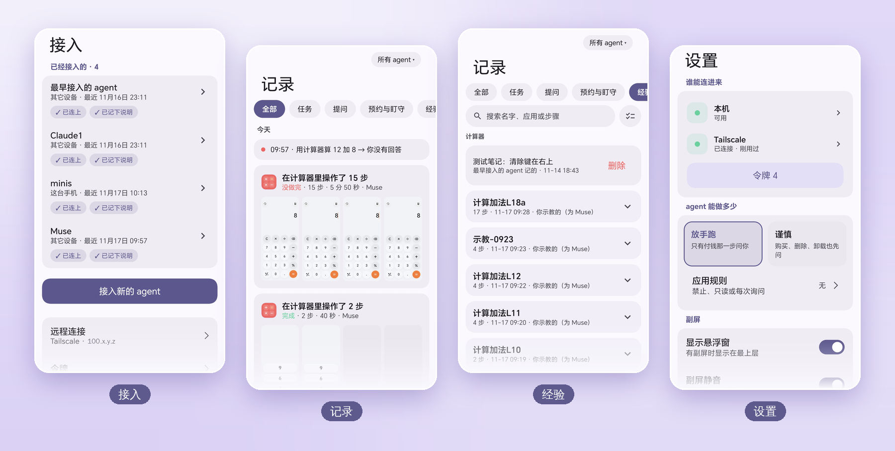

<p align="center"></p>

# Agent-VScreen

<p align="center">
  <a href="https://github.com/kilolonion/agent-vscreen/releases/latest"></a>
  <a href="LICENSE"></a>
  
  
  
</p>

给任何手机 agent 用的**后台副屏**。

中文 · [English](README.md)

Agent-VScreen 在一块看不见的虚拟屏上打开和操作别的应用，你的主屏照常用，不会被打断。屏幕上只有一个悬浮小窗，让你看到 AI 在做什么，随时可以接管或叫停。

手机上的任何 agent 都可以调用它：带终端的 agent 用命令行 `vscreen`，支持 MCP 的用 MCP，自己写代码的用 HTTP。

<p align="center"></p>
<p align="center"><sub>左：agent 在后台副屏里打开 Chrome 解数独（8 倍速）。右：agent 在后台副屏里玩洛克王国，完成横屏启动、摇杆长按走动、拖动镜头和战斗弹窗操作（2.6 倍速）。两边用户的主屏都仍是聊天界面。</sub></p>

<p align="center"></p>
<p align="center"><sub>同一条安装命令，Minis、Eta、RikkaHub、Muse 四个不同的安卓 agent 都能接入并操作副屏。</sub></p>

<p align="center"></p>
<p align="center"><sub>App 界面：语言切换、首次配置、接入 agent（本机 / Tailscale，命令行 / MCP / HTTP）、设置、应用限制和诊断。</sub></p>

- 版本：1.3.0（versionCode 33）
- 包名：`com.kilon.agentvscreen`
- 系统：Android 11 及以上，推荐 Android 14 及以上
- 特权：只用 [Shizuku](https://shizuku.rikka.app/)，不需要 root

## 它能做什么

- **后台操作应用**：在副屏上启动应用、点击、滑动、输入文字、按键、等待画面变化，每一步都会核对结果。
- **把画面报告给 agent**：每次操作后返回现在的界面、能看到的文字和可点的元素，并附上截图。本应用不调用任何大模型，画面是什么意思由 agent 自己的模型判断。
- **盯守**：让副屏盯着某个条件（比如出现某段文字），满足时通知 agent。
- **悬浮窗**：
  - 边框的颜色表示现在谁在用副屏：彩虹色是 AI 在操作，蓝色是待命，绿色是你接管了，红色是你叫停了；
  - 拖动可以移动，双指捏合可以缩放；松手时手指还在动，小窗会顺势滑一段；
  - 拖出屏幕一半或甩向两边，窗口顺着手势滑进边缘，折成贴边的小标签，点标签沿原路滑出来；
  - 按住画面 0.5 秒（有进度环）就能接管；标题、按钮和提问卡各自接住触摸，不会点穿到副屏；
  - 右上角 × 点一下就关：AI 在工作时只收起小窗，AI 继续在后台干活；没有任务时直接关掉副屏。关闭不会停住 AI；
  - AI 在操作或等待时，底部中间有“停止 AI”，点它才会停住 AI；停住后同一位置变成“交还 AI”，通知栏也一直有提示；
  - 也可以打开原生全屏页：画面固定不动，键盘、打字框和提问卡浮在上面；进入框选、指给我看这类回答页时悬浮窗自动让开，答完回来。
- **不和 agent 抢权限**：不占用 adb，不改无线调试的开关和端口，不重启 adbd。你的 agent 自己用的 adb 或 Shizuku 照常可用。一键配置只会把本应用“加进去”，不会改动别的应用的设置。

## agent 能用它做什么

这份清单和 agent 收到的说明来自同一张能力表（`Abilities.kt`），由测试自动写入，不要手改。

<!-- abilities:start -->
- **用户要我在手机上做任何事：打开某个应用、查信息、比价、看某页内容、填表、发帖、测试应用……**：`vscreen launch <应用>` 打开并看，`vscreen act "<步骤>"` 点、滑、输入、按键，每次都返回截图和元素列表
- **用户要我定时、每天、每周或到某个时间去做（签到、打卡、抢购、定时查看、提醒）**：用我自己的定时任务功能按时运行，并用 `vscreen schedule "<时间>"` 预约，手机会在每次之前拉起服务、检查权限，没准备好就提醒用户
- **要等一件以后才发生的事：到货、降价、有回复、直播开始、排队轮到、下载完成**：`vscreen act --stop "text:到货" --keep notify` 让手机一直盯着，看到就通知用户（`--keep wake` 改成叫醒我，用 `vscreen events` 取）
- **要读完一个很长的列表或整页内容（全部订单、聊天记录、搜索结果、评论）**：`vscreen collect --pages 10` 自动翻页，返回去重后的每一条
- **不确定用户指的是画面上哪个东西（哪个商品、哪个按钮、哪条消息），或要用户选一个**：`vscreen ask "你说的是哪一个？"` 让用户在手机上的副屏画面里点出来（也可以 `--choose`、`--text`）
- **一个流程说不清、试了几次都不对，或用户自己更清楚怎么做**：`vscreen teach "要演示什么"` 请用户在副屏上亲手做一遍，存成一段，之后 `act "use 段名 参数"` 照做
- **同一个应用会反复用：有固定入口、每次都弹的窗、要先暂停的画面，或对机器节奏敏感**：`vscreen note` 给这个应用记经验、存步骤（`note save`）、设前置/收尾步骤和仿人节奏，下次 launch 会列出来
- **有一步只能用户本人做（密码、验证码、人脸、扫码），或要用的应用用户正在用**：`vscreen handoff out` 把应用交到用户主屏并告诉他做什么；`vscreen handoff in` 把主屏上的应用接到副屏
- **画面上的字太小、是图标，或者根本没有字（游戏、画布、图表），或想回看刚才发生了什么**：`vscreen look` 要图：现在的画面、放大一块、回看录像都用它；`vscreen spots` 找可点的色块
- **连不上手机、命令一直失败或出了怪问题**：先分清是没开还是坏了：没在运行、服务关着或收起是用户的选择，转告用户打开即可，不用修；`vscreen status` 里 ready 为假时才是故障，`vscreen fix` 只修它列出的项
<!-- abilities:end -->

## 不只是一块副屏：围绕副屏的脚手架

Agent-VScreen 不只是一块能让 agent 用的虚拟屏，而是围绕副屏搭了一整套脚手架，让你自己的 agent 直接操作，并且看得清、跟得上时间、知道每一步是否真的做成了。

- **有时间感**：agent 工作时，后台每秒看副屏约 5 次，大约每秒读一次屏上的字，并记下时间。所以每次返回的【这段时间】会写出从上次返回到现在（包括 agent 思考、调别的工具的那几秒）出现、消失、一闪而过的字，画面哪里变了、变了多久，有变化时还附一张拼图。倒计时、加载、动画、弹窗这类会变的画面也跟得上。
- **能等、能盯**：每个动作后可以加 `until` 条件（出现某字、某字消失、画面变化、画面静止、某点颜色、切到某应用），写明最长等多久，等不到会照实说。`--stop` 在整段操作里一直盯着，`--watch` 做完再多看一会儿。`--keep notify|wake` 在这一轮结束后继续替 agent 盯，条件出现就通知用户或叫醒 agent。实时游戏记下暂停和继续两步后，每段操作会自动先继续、末尾暂停，变成回合制。
- **看得清**：无障碍控件树和本机 OCR（内置 ML Kit，默认用更准的 PP-OCRv6（tiny 检测 + small 识别），都在手机上离线运行）合并成带编号和坐标的元素列表，`tap #N` 或 `tap 画面上的字` 都能点。OCR 按字符切分，同一行里的几个标签能分开点，也能只点一段字的中心。另外有本地按颜色找色块（`spots`）、带坐标刻度的放大图（`zoom`）、边滚边收集整页文字并去重（`collect`）。
- **每步都核对**：一步没达到预期（`until` 没等到、字没输进框里、焦点不在刚点的地方）就停在那一步，后面的不做，并写明现在的画面；没点中时会列出最接近的候选。
- **多方协作**：会话机制让多个 agent 轮流用同一块副屏（别人在用时返回 `BUSY`，写明多久后让出）；`handoff in/out` 把用户主屏上正在用的应用接过来或交还；用户随时能接管或叫停；应用限制（禁止或只读）和付费按钮的确认拦截（`CONFIRM_REQUIRED`）。每个应用还能记笔记、存操作段（`--save` / `use`），下次打开时列出来。
- **不绑模型，不抢权限**：手机侧不调用任何模型，画面是什么意思由调用方的模型判断。只用 Shizuku，不需要配对无线调试，也不占用 adb。

## 安装和配置

1. 安装 APK，打开 Agent-VScreen。
2. 确认 Shizuku 已经启动，然后点 **授权 Shizuku**。
3. 点 **一键配置其余项**：悬浮窗、通知、只读无障碍、电池优化和后台运行。荣耀、华为、小米、OPPO、vivo 等手机还有一项 **系统后台管理**，点 **去设置后台管理**，把 Agent-VScreen 改成手动管理，允许自启动、关联启动和后台活动。
   - 无障碍建议打开。开着它，悬浮窗不会在设置、安装器这类页面上被系统藏起来，元素列表和中文输入也更准。
4. 在 **接入 agent** 里点 **复制给 agent 的话**，原样发给你的 agent。它会装好 `vscreen` 命令，并按你的要求把一段说明存进它自己的长期记忆，以后的新对话里也知道手机上有这个工具。首页会显示它有没有记住。之后就能用 `vscreen` 了：

```sh
vscreen launch 设置
vscreen act "tap 搜索; type 关于手机; key enter until text:关于手机"
vscreen help all
```

### 荣耀、华为、小米等手机

这些系统的后台管理可能会把后台应用冻结。冻结后，agent 的命令会一直没有回应，直到你打开 Agent-VScreen。

1.1.3 做了这些防护：

- 服务运行时一直保留一个透明的 1 像素悬浮窗；
- 前台服务启动被拒时，改用 shell 身份重新启动；
- 每秒自检一次有没有被冻结。

如果首页出现 **后台运行受限**，点 **去设置**，把 Agent-VScreen 设为允许自启动、关联启动和后台活动。荣耀和华为在“应用启动管理”里改成“手动管理”。

## 在 Operit 中使用

下面以 Operit 为例。这不是专门为 Operit 做的适配：同一台手机上的其他安卓 agent，按“接入 agent”里的命令行、MCP 或 HTTP 方式默认安装就能用；云端或电脑上的 agent 用 Tailscale 连进来，见下一节。

有两种接法，任选一种：

- **ToolPkg（推荐）**：导入 [`integrations/operit`](integrations/operit/) 打出的 `agent-vscreen.toolpkg`（Releases 里也有），把令牌发给 Operit 的 AI 让它保存就能用，截图会直接给到模型。详见那个目录的 README。
- **远程 MCP**：Operit 和 Operit 2 都能连远程 MCP，不用装任何插件，步骤如下。

1. 在 Agent-VScreen 里完成首次配置，确认服务在运行。
2. 在 **接入 agent → MCP** 里复制令牌。
3. 打开 Operit 的 MCP 管理页，点 **导入/连接 → 连接远程**，填：
   - 名称（插件 ID）：`vscreen`
   - 地址：`http://127.0.0.1:18765/mcp`（18765 是默认端口，在 App 里改过端口的话换成你的）
   - 连接方式：`httpStream`
   - Bearer Token：刚复制的令牌
4. 保存后打开它的开关。远程插件不用点“部署”，状态变成 active 就能用。
5. 在聊天里试一句：“用 vscreen 在虚拟屏打开设置，告诉我系统版本。”

也可以用 **配置导入**，粘贴下面的 JSON 后点 **合并配置**：

```json
{
  "mcpServers": {
    "vscreen": {
      "url": "http://127.0.0.1:18765/mcp",
      "headers": { "Authorization": "Bearer <令牌>" }
    }
  }
}
```

注意：

- Operit 和 Agent-VScreen 要在同一台手机上。Operit 在别的设备上时，把地址换成 Tailscale 地址，见下一节。
- Operit 自带的屏幕操作工具和 vscreen 可以共存。想让它只用副屏，在角色提示词里写：“操作其它应用时一律用 vscreen 工具，不要动主屏。”
- 令牌等于这台手机的操作权限，不要贴进公开的角色卡、分享的配置或截图。

## 让其它设备连进来（可选，默认关闭）

服务默认只监听本机的 `127.0.0.1:18765`。要从电脑或另一台手机调用，在“接入 agent”第一步 **agent 在哪** 选 **其它设备上（Tailscale）**，再选 **内置**：不用装 Tailscale App，也不占系统 VPN，在 App 里登录一次 Tailscale 就行，只有你自己 Tailscale 网络里的设备连得进来。已经装了 Tailscale App 的也可以选 **Tailscale App**，或者用 SSH 端口转发。

自建的 Headscale 也能用：在 **高级选项** 里填它的地址（比如 `hs.example.com`，`https://` 会自动补上），再打开注册页或填预授权 key。每个服务器的登录分开保存。内置节点只负责让其它设备连到 Agent-VScreen，不接管手机自己的上网，所以没有出口节点；手机要靠出口节点上网时，让 Tailscale App 一直开着，选 **Tailscale App** 模式就行。

Tailscale 的设置就在这个选项下面。连好后，下面复制的给 agent 的话、安装命令、MCP 配置和能力说明就都换成 Tailscale 地址，直接发给那台设备上的 agent。

令牌等于这台手机的操作权限，所以本应用不提供公网链接。

## 文档

- [API.md](API.md)：完整的接口说明，包括命令行、MCP、HTTP、会话、盯守、权限和安全、悬浮窗、远程连接、已知限制和从 1.1 升级。
- [docs/REFERENCE.md](docs/REFERENCE.md)：每条命令的参数和每个结果代码（由代码生成）。
- [docs/TASKS.md](docs/TASKS.md)：发版前在真机上跑的固定任务集。

## 1.3.0 更新内容

**一套步骤语言：脚本、存下的段和示教都用它**

- 字里可以写 `*`（任意字）：`tap *蓝牙*` 点含“蓝牙”的那一项，`wait text:共*条`；`字@2` 点从上往下第 2 处，`@-1` 是最后一处。同样的字有几处时，回复里每一处都标好 `@N`。
- 流程：`try 一步` 或 `try { … }`（没找到、没达到预期就跳过，接着做）；`if text:关闭 { tap 关闭 } else { back }`；`repeat 3 { scroll down }`、`repeat { scroll down } until text:到底了`。括号里可以换行、可以嵌套。写错时整段不执行，并说明该怎么写。
- `note save 名字 "步骤"` 不执行，直接存下或改写一个段，示教存的段也一样。
- **仿人节奏**：`act --human`，或者 `note human on` 让这个应用一直这样。每个动作前随机停一下，点击在元素里略偏、按住时长不固定，滑动和拖动的时长、起止点有波动，打字一次 1 到 3 个字。等待和条件判断不变。

**你教它、它问你**

- **示教**：在副屏上亲手做一遍，存成 agent 能重放的一段。接管副屏后点底栏的录制键，照常操作，做完点“完成”；审阅页里每一步都写着它是怎么来的，可以取消误点的步骤、起名字再保存。点在画面上的字记成 `tap 字`（布局变了也找得到），找不到唯一的字才记坐标；每一步之后新出现的字、换到的应用记成 `until`，重放时等到同样的结果才往下走。输入的字默认变成空位 `{1}`，agent 用 `use 名字 内容…` 填；密码从不保存。agent 也可以用 `vscreen teach "要演示什么"` 请你演示，手机上点“去演示”直接开始录。
- **指给我看**：`vscreen ask "你说的是哪一个？"` 把问题放到手机上，你在副屏画面上点一下，agent 拿到坐标和那里的元素。也支持框选、选择题和文字回答；`--async` 时一直等到你回答。
- **示教更顺手**：点“去演示”立刻接管并开始录，点“完成”同时交还。打字后点了搜索结果，存成“第 N 个含输入内容的项”（`tap *{1}*@2`），换个词重放时按内容去点，不是点同一个位置。存下的示教带一张关键步骤缩略图（红圈是点的位置），agent 在 teach 的回复里拿到，之后用 `note show 名字` 再看。App 里“定时与示教”页可以搜示教、多选删除，带括号的段按缩进显示。
- **有事问你时，悬浮窗自己会提醒**：收在边上的胶囊变成紫色问号；展开悬浮窗或全屏，确认题和选择题直接在上面点。

**看得清、点得准**

- **核对只认动作之后的画面**：`until text:…` 只算动作之后新出现的字，等应用对这一下有反应、画面稳定后才判断；画面一直没变会直接说“应用没有反应”。
- **编号属于一个页面**：换了页面，旧的 `#编号` 报 `STALE_ELEMENT`，不会点到新页面上同名的字。
- **一直在动的区域**（视频、直播、轮播）会被认出来，不再拖慢每一步，也不再把弹幕列成变化。
- **看得到自己点在哪**：【这段时间】的拼图每个动作前一张，圈出点的位置，空位给动作之后的结果。`vscreen frames` 回看录像，可以要更长、更密或指定的一段。
- **一处一条元素**：有无障碍文字的地方不再重复列出 OCR；`collect` 按卡片收集，双列不再拼在一起；顶部和底部的标签栏不算条目；滑一次画面没动不算到底，要再换个位置确认。
- **按文字点更快**：`tap 字` 先在应用自己的控件里找，能定下来就不用等整屏识别。
- **耗时如实写**：每条回执写手机端用了多久、花在哪；命令和存活检查同时发出，截图更小。

**随叫随到，也能完全不打扰**

- **定时预约**：`vscreen schedule "weekdays 07:00"` 预约 agent 会来用手机的时间，到点前拉起服务、检查连接，有问题提前通知你；也可以只约一次（`today 10:30`）。`status` 开头的 `ready` 一眼说明能不能用。
- **常驻 / 收起 / 禁止访问**：开关打开是常驻；关掉是收起，通知和后台都消失，本机 agent 或预约到点会把它叫醒，用完再收起；“禁止 agent 访问”是真正的关闭。
- **副屏静音**：副屏里的应用不从手机放声音。
- **主屏提示只在我们打扰时出现**：你在主屏上照常切换应用不再报。
- **App 更新后，agent 会知道**：每个 agent 下一次用 vscreen 时会看到这几版和它有关的变化，并被提醒更新自己记下的说明。

**远程更稳**

- **内置 Tailscale**：同一时间只跑一个节点，跟着 App 进程走，App 被系统重启后不再几分钟连不上；连不上服务器时保留登录、显示“断开了，重连中”，不再要你重新登录；“已连上”按真实连接显示，写明中继和断开次数。
- **经内置 Tailscale 只要令牌**，不用签名，MCP 客户端可以直接远程接入。
- **命令行不再挂着**：本机 App 没响应会先唤醒再重试；命令执行中手机上的 App 重启或一分钟不回应时停下说明原因；远程连不上时说清可能是收起、禁止、没网还是掉了登录。`VSCREEN_PROXY` 可以指定代理。
- 日志和 `status` 记下上一个 App 进程为什么结束；App 进出前台、系统冻结、节点停顿也都有记录。

**界面**

- 首页只放开关、副屏状态、等你处理的事和一组卡片（接入 agent、权限、副屏与悬浮窗、定时与示教、操作日志、首次配置），每张写着最要紧的一项状态；说明收进“?”。App、悬浮窗和全屏统一成紫色系的玻璃质感。
- **检查更新**：首页列表里点“检查更新”查 GitHub 上的发布，有新版会显示更新说明和下载链接；打开 App 时每天最多自动查一次。
- Shizuku 授权按钮每种情况都有反应：已授权、Shizuku 没运行、之前被拒或没弹框时，都会说明并带你去对应的地方；回到 App 会重新读授权状态。

还没在所有机型上验证：厂商后台管理对已冻结的 App 是否放行精确闹钟和唤醒广播；MagicOS 上用 `PLAY_AUDIO` 静音是否对所有播放器有效。

## 1.2.0 更新内容

这一版重做了命令入口、返回格式、安全模型和给 agent 的说明，并在真机上按 [docs/TASKS.md](docs/TASKS.md) 跑过两轮回归（荣耀 Magic 7，MagicOS 11）。从 1.1 升级的对照表在 [API.md 第 9 节](API.md)。

- **结果是结构化的**：每次回复带 `ok`、`code`、`next`（建议的下一步：先看画面 / 改命令 / 问用户 / 稍后重试），以及每一步的状态、画面元素和提示。一段操作停在某一步时结果就是失败，不用再从文字里判断。新接口是 `/v2`，`/v1` 行为不变，再保留一个版本。
- **一张命令表**：参数检查、帮助、MCP 工具的参数和文档都从同一张表生成。MCP 除了 `vscreen`，每条命令有自己的工具，参数是字段。
- **点得更准**：同样的字有好几处时不再点第一个，而是列出每一处让 agent 选；`#编号` 指的元素不在原位时不再点旧坐标；动作后画面完全没变会提示。
- **等得更短**：页面上只剩转圈、光标闪烁这类小动画时算稳定，不再每一步等满 3 秒。感知改成新画面驱动。
- **输入只走一条通道**：点击、滑动、按键全部由副屏服务注入，去掉了解析 dumpsys 文本和调用 shell `input` 的旧路径。
- **每个 agent 一个令牌**：可以限定只看 / 可操作 / 全部，单独撤销，会话互不相干。
- **请求签名**：从其它设备连接时令牌不上网络，请求不能重放或改动，回复也校验。命令行自动完成。
- **用户在手机上确认**：付费、不可撤销、强制结束、接走主屏应用、设为“每次询问”的应用，都由你在手机上点允许。agent 自己加参数不再算数。可以给信任的 agent 开 30 分钟免确认。
- **操作日志**：每条命令谁做的、什么时候、结果如何。输入的文字只记字数。
- **不容易被拖垮**：HTTP 服务有连接数上限、请求大小和时间限制；调用方断开后命令会停下；同一个请求重发不会执行两遍；长操作可以 `--async` 后用 `task` 取结果；命令排队执行。
- **事件不丢**：盯守的事件保留到下一次取，可以重取，写在磁盘上；盯守在 App 重启后接着盯；事件广播默认不发，只发给你指定的应用。
- **给 agent 的说明重写了**：围绕“看 → 做 → 核对”一个循环，按结果代码写明每种情况下一步怎么办，`vscreen guide` 一页讲完。
- **其它**：`note before` / `note after` 取代暂停 / 继续步骤；`--fast`；`vscreen diag` 导出诊断；截图随副屏清理；厂商差异收进一层；去掉了早期遗留的代码和名字。

- **默认放手跑**：App 的“权限”里有两档。默认“放手跑”只有真正付钱的那一步（支付、提交订单、转账、充值）和你设为“每次询问”的应用会在手机上问你；“谨慎”档再加上删除这类不可撤销的按钮、去购买的步骤、强制结束和接走主屏应用。输入框旁边的“清空”不再被当成不可撤销。
- **页面重排**：首页按“接入 → 权限 → 设置 → 操作日志”排，权限一处管（档位、应用限制、令牌），设置按悬浮窗 / 副屏 / 识别和记录分组。
- **悬浮窗更顺**：画面单独按显示尺寸缩小、每秒 20 帧（接管时 30 帧），不再用 agent 的整幅截图；拖动窗口每帧只更新一次位置，不再拖后；接管后手指按下就传到副屏，列表跟着手指走，不再松手才动。横屏副屏默认几乎和手机一样宽，横竖屏各记各的大小。
- **只看令牌能看了**：只看令牌的 `act`（不带步骤或只有 wait）看的是当前那块副屏；`stop --force`、`handoff in` 需要“全部”范围。
- **编号不会认错人**：同一块副屏上，一个编号只指一个元素；滚动后同一个元素保留原编号，新元素拿新编号。用了已经不在画面上的旧编号会得到 STALE_ELEMENT，不会点到别的东西。
- **悬浮窗**：横屏副屏默认约为手机宽度的四分之三，出现和换方向时整个窗口都留在屏幕内。
## 1.1.x 更新内容

- **1.1.8**
  - 内置 Tailscale 支持自建 Headscale：控制服务器地址不写 `https://` 也行（以前少了它节点会一直停在 NeedsLogin，页面却说连不上 Tailscale 官方服务器）；每个服务器的登录状态分开保存，从 Tailscale 换到 Headscale 不会带着旧的登录，填了预授权 key 一定会用它注册；连不上时页面直接写出是哪个服务器、出了什么错；注册页的说明也按 Headscale 写；
  - 内置节点不接管手机上网，所以不提供出口节点。检测到 Tailscale App 已经连着时，页面会建议直接用“外部 App”模式（手机靠出口节点上网时本来就要开着 App）；
- **1.1.7**
  - “接入 agent”重新排版：先选 agent 在哪（这台手机 / 其它设备），选其它设备时 Tailscale 设置就在下面，再选接入方式、复制、令牌；区分本机和其它设备的切换一直显示，Tailscale 地址短暂读不到时复制的地址也不会跳回 127.0.0.1；
  - “后台运行受限”的提醒和“系统后台管理”这一项用同一个判断：点“去设置”后提醒立刻消失，只有之后亮屏时又被冻结才会再出现；
  - 支持英语：首页“首次配置”上方的“语言 / Language”卡片里可以选“跟随系统 / 中文 / English”，App 界面、悬浮窗、通知，以及给 agent 的话、能力说明、skill、命令返回和 help 都跟着换。已安装的命令行会在下一次调用时自动换成新语言；
  - 远程也能一键复制：选“其它设备上（Tailscale）”并连好后，复制的内容直接带 Tailscale 地址；
  - 能力说明重写：存进 agent 记忆的是“我能在用户手机上后台操作应用”这项能力本身，写明什么时候用、怎么开始、连不上时怎么办，而不只是一条安装记录；
  - 修复：内置 Tailscale 有时一直显示 NeedsLogin、不出现登录按钮。现在拿不到登录链接时会自动反复去要，页面上写明在等什么，可以手动“重新获取登录链接”；连不上 Tailscale 服务器时会直接说明。
- **1.1.6**
  - 内置 Tailscale：不用另装 Tailscale App，在 App 里登录一次，电脑就能远程调用；不占系统 VPN；
  - 接入改成“复制给 agent 的话”：让 agent 自己把说明存进长期记忆，并报告存在哪；首页显示 agent 有没有记住；新增 `vscreen guide`，MCP 连接时自带用法；
  - 悬浮窗的关闭和停止分开：× 点一下就收起或关闭，不会再顺带停住 AI；“停止 AI”单独放在左下角，停住后有常驻通知和“允许继续”，agent 收到的提示也写明用户怎么解除；
  - 修复：电池白名单被系统收回后首页反复显示没配置（现在自动补上），熄屏时的冻结不再让“系统后台管理”重新亮起。
- **1.1.5**
  - 修复：用户接管过副屏或从悬浮窗关掉副屏后，agent 的动作一直被要求“先看清画面”。现在 launch 和 act 返回的画面就算看过，launch 打开新页面也不会被拒；
  - 命令行每次的完整输出另存到截图目录的 `last.txt`，输出太长时可以分段读；
  - 副屏上没有应用时提示用 launch 打开；“画面一直在变”和“画面没变”两句说法不再矛盾；
  - 新 logo：手机上叠一个彩虹边框的悬浮小窗。
- **1.1.4**
  - 安装命令会顺带输出一份 skill，agent 存进自己的 skill 或记忆后，就知道操作应用要用 vscreen，不需要 adb；
  - “系统后台管理”成为配置项，可以一键打开厂商的后台设置页；
  - 小窗拖到屏幕边缘时，以手指为中心连续缩成标签，拉出时从手指的位置长出来；
  - 首页的设置区块样式统一；logo 和标签里的副屏改成带导航条的小屏和触点。
- **1.1.3**
  - 修复：没有副屏时，App 在后台被冻结，命令要等你切回 App 才有回应。
  - 端口被占用时会自动重试，并写明被谁占用；首页可以立即重试或换端口。
  - 命令行 5 秒内就能认出 App 被冻结，不再干等；连本机时不走代理。
  - 贴边小标签换了新样式，会落在你松手的位置；“首次配置”加了展开和收起提示。
- **1.1.2**：打开全屏页时自动藏起悬浮窗；加了惯性甩动、甩到角落缩小、靠边折叠。
- **1.1.1**：悬浮窗挂在无障碍服务下面，不再在设置、安装器这类页面上消失；通知栏加了“查看副屏”；加了 Tailscale 模式。
- **1.1.0**：重做悬浮窗、全屏页、首页和图标；一步没达到预期就停在那一步；加了 `title`、`done`；命令行随 App 自动更新。

## 从源码编译

需要 JDK 17、Android SDK（compileSdk 36）。

```bash
echo "sdk.dir=/path/to/android-sdk" > local.properties
./gradlew :app:assembleRelease
```

内置 Tailscale 是一个用 Go 编的小程序（`tsbridge/`），需要 Go 1.21 以上（会按 `tsbridge/go.mod` 自动下载 Go 1.27.3）。编 APK 之前先运行一次 `tsbridge/build.sh`，它会生成 `app/src/main/jniLibs/arm64-v8a/libtsbridge.so`；不运行也能编，只是 App 里没有内置 Tailscale。

正式签名可选：把 `keystore.properties.example` 复制成 `keystore.properties` 并填好。不填的话，release 包用 debug 密钥签名。

## 许可

MIT。内置的 OCR 模型（`app/src/main/assets/vscreen-ocr/`）来自 PaddleOCR，沿用它自己的 Apache-2.0 许可。

## 致谢

- [LINUX DO](https://linux.do)
- [OpenMinis](https://github.com/OpenMinis)
